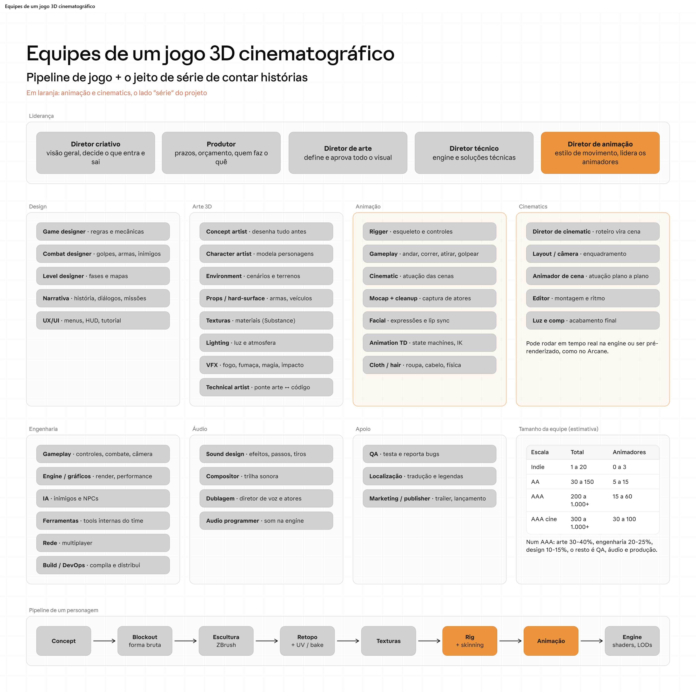

# OpenGlitch

[](https://github.com/joaquimmoraesgabriel-cmyk/OpenGlitch/actions/workflows/testes.yml)

Um PageIndex sobre criação de jogos 3D cinematográficos e uma equipe de agentes
de IA que o usam, servidos por MCP. Você conecta o Claude, o Codex ou outro
cliente MCP a este servidor; a IA analisa o seu pedido, assume o agente certo
(design, arte 3D, animação, cinematics, engenharia, áudio ou apoio) e trabalha
no seu jogo seguindo a skill daquele agente.



Cada área do quadro é um agente, e cada função dentro dela é um subagente
pesquisador. O conteúdo vem de um guia de estudo sobre essas equipes, transcrito
em `sources/guia-pdf.md`. O que no guia era "como estudar" virou o modo de
trabalhar dos agentes e as referências de pesquisa dos subagentes.

## Como funciona

```
usuário ──> IA ──start──> roteador: analisa o pedido e escolhe o agente
                 │
                 ├─ activate_agent ──> a IA vira o agente (skill + brief + memória)
                 │       │
                 │       ├─ consulta a memória (memory_search / memory_tree)
                 │       ├─ faltou algo: delegate_research ──> subagente (em paralelo)
                 │       │        └─ pesquisa nas referências dele:
                 │       │           research_text / research_tables / research_images
                 │       │           grava na própria memória e entrega o relatório
                 │       ├─ constrói (com as ferramentas do cliente)
                 │       └─ registra na memória de trabalho
                 └─ finish_agent ──> recado para o próximo agente
```

- **Agente constrói, subagente pesquisa.** O agente não abre as referências; o
  subagente não constrói, não escreve código e não fala com o usuário.
- **Três jeitos de usar**, conforme o que você tem:
  - *Jogo novo*: o Design conversa com você até entender o jogo e publica o
    brief. É obrigatório, porque todas as áreas trabalham a partir dele.
  - *Jogo que já existe*: o Design lê a pasta do projeto, escreve um brief
    curto com o que encontrou e confirma em poucas perguntas. Sem entrevista.
  - *Tarefa solta* (um objeto, uma animação, um shader, um script): o agente da
    área trabalha direto, sem Design e sem brief.
- **Um agente por vez** em cada projeto. Os subagentes dele podem pesquisar ao
  mesmo tempo que ele trabalha.
- **Na segunda vez não se pesquisa de novo**: o agente olha a memória antes de
  delegar.
- **Cada agente tem um método de qualidade** (`METODO.md`): decompor o trabalho,
  pesquisar com os subagentes antes de construir, evitar os sinais de trabalho
  genérico e conferir o resultado por capturas e testes antes de entregar.
- **O servidor anota como o trabalho foi feito**: se o agente registrou a
  decomposição antes de construir, quantas pesquisas delegou e que partes do
  método leu. Fica no histórico do projeto (`project_status`).
- **Ninguém finge que funcionou.** O que o agente não conseguiu fazer, fez de
  outro jeito ou fez sem conferir, ele avisa na hora e registra
  (`report_problem`). `list_problems` mostra tudo o que já foi relatado.
- **O agente `leitor`** só lê. Serve para perguntar como o projeto está e para
  descobrir que agente, ou que sequência de agentes, atende um pedido.

## Agentes e subagentes

| Agente | Subagentes pesquisadores |
| --- | --- |
| `design` | game-designer, combat-designer, level-designer, narrative-designer, ux-ui-designer |
| `arte-3d` | concept-artist, character-artist, environment-artist, props-hard-surface, texture-material, lighting-artist, vfx-artist, technical-artist |
| `animacao` | rigger, gameplay-animator, cinematic-animator, mocap-cleanup, facial-animation, animation-td, cloth-hair-physics |
| `cinematics` | cinematic-director, layout-camera, scene-animator, editor, lighting-comp |
| `engenharia` | gameplay-programmer, engine-graphics, ai-programmer, tools-programmer, network-programmer, build-devops |
| `audio` | sound-designer, composer, voice-over, audio-programmer |
| `apoio` | qa, localization, marketing-publisher |
| `leitor` | nenhum: só lê as memórias |

A liderança do guia (diretor criativo, produtor, diretores de arte, técnico e de
animação) não é um agente. A visão e o escopo ficam com o `design` e com você; a
direção de arte, a técnica e a de animação ficam com os agentes dessas áreas. O
conteúdo está em `knowledge/lideranca/`.

## Memória

Cada memória é um PageIndex: uma árvore de nós com título, resumo, conteúdo,
fontes e histórico. O servidor decide quem acessa o quê:

| Quem | Lê | Escreve |
| --- | --- | --- |
| Subagente | Só a própria memória, e só se o agente ligou `memory_access` na tarefa | Só a própria memória |
| Agente | A memória de todos os seus subagentes e a sua memória de trabalho | Só a sua memória de trabalho |
| Leitor | Todas, de todos os agentes | Nada |

Um agente não vê a memória de outro. O que passa de um para o outro é o brief
do projeto e o recado de encerramento (`finish_agent`).

Cada agente tem ainda uma memória de **lições**, que vale para todos os
projetos: quando ele resolve um erro (uma opção de importação que não funciona
como o nome diz, por exemplo), grava o sintoma, a causa e a solução, e recebe
essa lista ao ser ativado em qualquer projeto seguinte.

A memória de pesquisa dos subagentes vale para todos os projetos; a memória de
trabalho de cada agente é separada por projeto. Tudo fica em `.openglitch`, na
sua pasta de usuário.

## As três ferramentas de pesquisa

Só subagentes as usam, e só em páginas das próprias referências, em links
encontrados dentro delas ou em URLs que o agente incluiu na tarefa.

- **`research_text`**: o corpo do artigo em Markdown, com os títulos, sem menu
  nem rodapé (Trafilatura).
- **`research_tables`**: só as tabelas, convertidas para Markdown
  (BeautifulSoup acha cada `<table>`, `pandas.read_html` converte).
- **`research_images`** e **`research_view_image`**: só as imagens de conteúdo.
  O filtro (BeautifulSoup) descarta ícones, logos, avatares, banners, SVGs
  pequenos e tudo abaixo do tamanho mínimo (300 px por padrão). A imagem é
  baixada temporariamente para a IA olhar e descrever; fica guardado só o link
  original e a descrição.

**As referências são sites de terceiros e podem sair do ar**, mudar de
endereço ou passar a recusar acesso. Quando isso acontece, o subagente registra
o problema (`list_problems` mostra) e procura a resposta nos documentos locais:
cada subagente tem uma pasta `docs/` com material contribuído por pessoas, que
não depende da web. Se você encontrar uma referência quebrada, veja em
[CONTRIBUTING.md](CONTRIBUTING.md) como consertar.

O servidor se identifica como ferramenta ao abrir páginas. Sites que recusam
acesso automatizado não são contornados: a referência fica marcada como não
pesquisável. PDF e vídeo também não são lidos.

## Instalação

Você precisa de [Python 3.11 ou mais novo](https://www.python.org/downloads/) e
de [Git](https://git-scm.com/downloads). No Windows, marque "Add Python to PATH"
ao instalar o Python.

### Jeito 1: peça para a sua IA instalar

Há dois prompts. O primeiro instala o OpenGlitch e serve para qualquer
computador. O segundo instala também o MotionBricks e é só para quem tem placa
NVIDIA.

**Instalação padrão**

Funciona em clientes que rodam comandos no seu computador: Claude Code (inclusive
a aba Code do aplicativo Claude), Codex e Cursor. Cole este pedido:

```text
Instale o OpenGlitch para mim, um servidor MCP sobre criação de jogos 3D.

1. Confira se tenho Python 3.11 ou mais novo e Git. Se faltar algum, pare e me
   diga como instalar.
2. Clone https://github.com/joaquimmoraesgabriel-cmyk/OpenGlitch.git numa pasta
   permanente dentro da minha pasta de usuário, chamada OpenGlitch. Se ela já
   existir, entre nela e rode "git pull".
3. Dentro da pasta, rode "python install.py" (ou "python3 install.py") e me
   mostre a saída inteira.
4. Diga em quais clientes de IA ele foi registrado e me lembre de fechar e
   abrir o cliente de novo.

Use só o install.py do repositório para instalar e registrar. Não edite
arquivos de configuração à mão, a menos que o instalador falhe e eu autorize.
```

### Instalação completa, com o MotionBricks (só com GPU NVIDIA)

O [MotionBricks](https://github.com/NVlabs/motionbricks) é um modelo da NVIDIA
que gera o movimento de um personagem entre poses. No OpenGlitch ele é um
componente opcional do agente de animação. Só instale se o computador tiver
uma placa NVIDIA (a NVIDIA testou os exemplos numa RTX 4090; em placas menores
o desempenho não está documentado). Sem placa NVIDIA, use o prompt de cima: o
OpenGlitch funciona inteiro sem o MotionBricks.

Precisa, além de Python e Git, de [Git LFS](https://git-lfs.com/) e de
[uv](https://docs.astral.sh/uv/getting-started/installation/), e de alguns GB
de disco.

```text
Instale o OpenGlitch completo para mim, com o MotionBricks. Meu computador tem
placa NVIDIA.

1. Confira se tenho Python 3.11 ou mais novo, Git, Git LFS e uv, e se o comando
   "nvidia-smi" mostra a minha placa. Se faltar algo, pare e me diga como
   instalar.
2. Clone https://github.com/joaquimmoraesgabriel-cmyk/OpenGlitch.git numa pasta
   permanente dentro da minha pasta de usuário, chamada OpenGlitch. Se ela já
   existir, entre nela e rode "git pull".
3. Dentro da pasta, rode "python install.py --motionbricks" (ou "python3") e me
   mostre a saída inteira. O download do MotionBricks é grande e demora.
4. Me mostre o aviso de licenças do MotionBricks que o instalador imprime.
5. Rode o comando de teste que o instalador mostra no final. A primeira vez
   leva alguns minutos. Me diga se gerou o arquivo de animação ou qual foi o
   erro, sem tentar contornar.
6. Diga em quais clientes de IA o OpenGlitch foi registrado e me lembre de
   fechar e abrir o cliente de novo.

Use só o install.py do repositório para instalar e registrar. Não edite
arquivos de configuração à mão, a menos que o instalador falhe e eu autorize.
```

O chat comum, sem acesso ao terminal, não consegue instalar nada: nesse caso use
o jeito 2. Depois de instalado, o OpenGlitch funciona no chat também.

### Jeito 2: você mesmo, em três comandos

```powershell
git clone https://github.com/joaquimmoraesgabriel-cmyk/OpenGlitch.git
```

```powershell
cd OpenGlitch
```

```powershell
python install.py
```

Sem Git, baixe o ZIP do repositório (Code → Download ZIP), extraia numa pasta
permanente e rode `python install.py` dentro dela.

### O que o instalador faz

1. Cria um ambiente Python só do OpenGlitch (`.venv`, dentro da pasta) e instala
   o servidor. Não mexe no Python do sistema.
2. Confere o conteúdo (agentes, referências, base de conhecimento).
3. Registra o servidor nos clientes de IA que encontrar: Claude Code, aplicativo
   Claude (chat), Codex e Cursor. Antes de alterar um arquivo de configuração,
   salva uma cópia ao lado com o final `.bak-openglitch`.

Depois **feche o cliente de IA por completo e abra de novo**. No aplicativo
Claude para Windows, fechar a janela não basta: clique com o botão direito no
ícone da bandeja e escolha Sair.

Outras opções: `python install.py --dry-run` mostra o que seria feito sem
alterar nada; `--clients claude-code,codex` escolhe os clientes; `--uninstall`
remove o registro.

### Atualizar

Dentro da pasta, rode `git pull` e depois `python install.py` de novo. A memória
dos agentes fica em `.openglitch`, na sua pasta de usuário, e não é afetada.

### Outro cliente MCP

Qualquer cliente que aceite servidor MCP por stdio serve. O comando é o Python
do ambiente virtual com os argumentos `-m openglitch_mcp`; o instalador mostra o
caminho exato no final. No formato mais comum:

```json
{
  "mcpServers": {
    "openglitch": {
      "command": "C:\Users\voce\OpenGlitch\.venv\Scripts\python.exe",
      "args": ["-m", "openglitch_mcp"]
    }
  }
}
```

Variáveis de ambiente opcionais: `OPENGLITCH_DATA` muda a pasta da memória e
`OPENGLITCH_HOME` aponta para outra cópia de `agents/` e `knowledge/`.

### Não funcionou?

- **A IA diz que não conhece o OpenGlitch.** O cliente não foi reiniciado por
  completo, ou a conversa é antiga. Saia do cliente, abra de novo e comece uma
  conversa nova.
- **Não aparece na lista de plugins.** É esperado: o OpenGlitch é um servidor
  MCP, não um plugin. Basta pedir "Usa o OpenGlitch: ...".
- **O instalador não achou o seu cliente.** Registre à mão com o comando que ele
  mostra no final (seção "Outro cliente MCP").
- **Você moveu ou renomeou a pasta.** Os clientes apontam para ela. Rode
  `python install.py` de novo no lugar novo.
- **`python` não é reconhecido.** O Python não está instalado ou não está no
  PATH. No Windows, tente `py install.py`.

## MotionBricks (opcional)

Com o MotionBricks instalado, o agente de animação pode gerar movimento de
personagem em vez de só usar clipes prontos ou animar por script.

- **O que ele faz**: gera o movimento entre quatro poses de contexto e até
  quatro poses de destino. Cada geração dura de 0,6 a 1,9 s, e movimento longo
  é uma sequência de destinos que a IA planeja.
- **O que ele não faz**: não entende texto ("faça o personagem pular"). A IA
  dirige, escolhendo as poses de destino, onde ficam e em que ordem.
- **Como chega ao jogo**: o gerador grava um BVH no esqueleto SOMA, o Blender
  converte para FBX e a engine faz o retargeting para o seu personagem. Tudo
  acontece na sua máquina; o jogo recebe os arquivos de animação prontos.
- **Poses próprias**: o caminho padrão. A IA escreve as poses-chave do
  movimento (em pé, agachado, braço erguido) como direções dos ossos, e o
  modelo gera o caminho entre elas. Nada vem de clipe de terceiros.
- **Conferência**: junto do BVH saem uma tira de quadros do esqueleto, de lado
  e de frente, e medidas como pé afundando e pé deslizando. É como a IA confere
  o resultado sem assistir.
- **Licença, importante**: os clipes de exemplo que acompanham o MotionBricks
  só podem ser usados para avaliar e testar, e animação gerada a partir deles
  não pode entrar num jogo publicado. Com poses próprias esse limite não se
  aplica, mas leia o acordo dos modelos antes de vender o resultado:
  [licenças](https://github.com/NVlabs/motionbricks#license).

Estado atual: testado numa máquina, uma RTX 4050 de notebook com 6 GB, no
Windows. Com poses próprias, gerou agachar, levantar e erguer os braços, e
ciclos em loop de parado, andar para a frente e andar para trás, que foram
conferidos num personagem Humanoid com malha na Unity 6. Andar de lado só sai
como passo apressado. Ainda não foram testados movimentos difíceis (golpe,
salto, queda) e outros sistemas. Há planos de exemplo em
`extras/motionbricks/planos/`. Rode o teste que o instalador mostra
e, se falhar, abra uma issue com o erro. Os arquivos ficam em
`extras/motionbricks/`.

Ocupa cerca de 8,5 GB de disco e depende de downloads grandes: numa conexão
instável o instalador pode precisar ser rodado mais de uma vez, e ele retoma
de onde parou.

Para instalar depois, numa instalação que já existe: `python install.py
--motionbricks`. O agente consulta `motionbricks_info` para saber se o
componente está disponível.

## Usar com Unity, Unreal e Blender

O OpenGlitch dá à IA o conhecimento e o método; quem mexe na engine é a IA, com
as ferramentas que o seu cliente tiver. Sem nada além dele, os agentes trabalham
por script (o Blender em segundo plano, arquivos no projeto da engine). Com o
servidor MCP oficial do Blender ou o Unity CLI conectados ao mesmo cliente, o
método de cada agente manda preferir o programa aberto: rodar o script na cena
que você está vendo e conferir pela captura da tela. Abra o cliente na pasta do projeto do
jogo para ela criar e editar scripts, shaders, cenas e documentos. Se você
tiver um servidor MCP da própria ferramenta (Blender, Unity, Unreal) conectado
ao mesmo cliente, o agente usa os dois juntos: o OpenGlitch para saber o que
fazer e o da ferramenta para executar lá dentro.

## Como pedir

- "Usa o OpenGlitch: quero criar um jogo de ação em terceira pessoa com cenas
  tipo série." A IA assume o `design` e começa a entrevista.
- "Usa o OpenGlitch e seja o agente de animação: monta a animation list do
  protagonista."
- "Usa o OpenGlitch: como está o projeto?" A IA assume o `leitor`.
- "Usa o OpenGlitch: quero o primeiro personagem jogável." A IA monta a
  sequência do pipeline de personagem e segue um agente de cada vez.
- "Usa o OpenGlitch: já tenho um jogo na Unity nesta pasta e quero continuar.
  Preciso de um sistema de inventário." A IA faz a entrada rápida e passa para
  a engenharia.
- "Usa o OpenGlitch: só quero um ciclo de caminhada para este personagem no
  Blender." A IA assume a animação em modo avulso.
- "Usa o OpenGlitch, agente de engenharia em modo consulta: qual a diferença
  entre state machine e behavior tree?"

## Ferramentas MCP

| Grupo | Ferramentas |
| --- | --- |
| Roteamento | `start`, `project_status`, `plan_agents`, `get_pipeline` |
| Agente | `activate_agent`, `agent_method`, `register_decomposition`, `finish_agent`, `publish_project_brief` |
| Conhecimento | `knowledge_tree`, `knowledge_read`, `knowledge_search` |
| Memória | `memory_tree`, `memory_search`, `memory_read`, `memory_write` |
| Delegação | `delegate_research`, `task_status` |
| Documentos locais | `local_docs`, `local_doc_read` |
| MotionBricks (opcional) | `motionbricks_info` |
| Problemas | `report_problem`, `list_problems` |
| Subagente | `research_begin`, `research_text`, `research_tables`, `research_images`, `research_view_image`, `research_complete` |

## Pastas

```
agents/      skills e referências: um agente por pasta, um subagente por subpasta
             (cada subagente tem docs/ e docs/img/ para documentos contribuídos)
  _shared/   roteador, protocolos comuns e o contrato de formato (FORMATO.md)
  <agente>/  SKILL.md (o que faz), METODO.md (como fazer bem), agent.json
knowledge/   o PageIndex de conhecimento, em Markdown (index.json é a árvore gerada)
pipelines/   fluxos entre agentes (personagem, animação em jogo)
src/         o servidor MCP
tests/       testes das regras, das ferramentas e do fluxo por MCP
sources/     transcrição do guia que deu origem ao conteúdo
assets/      imagens do README
install.py   instalador: cria o ambiente e registra nos clientes de IA
extras/      componentes opcionais (motionbricks/: gerador de movimento, só GPU NVIDIA)
```

## Manutenção do conteúdo

```powershell
.\.venv\Scripts\python.exe -m openglitch_mcp.cli validate
```

```powershell
.\.venv\Scripts\python.exe -m openglitch_mcp.cli index
```

```powershell
.\.venv\Scripts\python.exe -m openglitch_mcp.cli links
```

`validate` confere agentes, referências, pipelines e documentos. `index` regrava
`knowledge/index.json`. `links` abre cada referência pesquisável e lista as que
falham. Para acrescentar um agente, um subagente ou uma referência, siga
`agents/_shared/FORMATO.md` e rode `validate`.

## Contribuir

O OpenGlitch melhora com uso real, e você não precisa programar para ajudar:

- **Documentos novos para a IA consultar**: métodos, exemplos trabalhados,
  receitas para Unity, Unreal e Blender, erros comuns. São arquivos Markdown
  na pasta `docs/` de cada subagente, com imagens em `docs/img/`.
- **Referências** novas ou corrigidas para os subagentes pesquisarem.
- **Relatos de erro**, principalmente em Linux e macOS, onde o projeto foi
  menos testado.
- **Correções** no servidor, no instalador e nas skills.

O passo a passo está em [CONTRIBUTING.md](CONTRIBUTING.md). Toda mudança entra
por pull request, revisada pelo mantenedor. Se for pedir a uma IA para preparar
a contribuição, mande-a ler o `CONTRIBUTING.md` primeiro.

## Segurança

O servidor roda no seu computador, não envia telemetria e só acessa a internet
para ler as páginas das referências. O que ele faz, os riscos e como relatar
uma falha estão em [SECURITY.md](SECURITY.md).

## Licença

[Apache 2.0](LICENSE): você pode usar, modificar e distribuir, inclusive em
projetos comerciais, mantendo o aviso de licença. O OpenGlitch não tem relação
com as ferramentas, engines e sites citados; as referências pertencem aos seus
autores.

## Limites conhecidos

- As permissões valem por credencial: o agente tem um `session` e cada
  subagente um `ticket` de uma tarefa. Um cliente sem subagentes nativos
  executa a pesquisa na mesma conversa, alternando de papel com o ticket.
- Várias referências do guia são livros pagos, canais de vídeo ou PDFs. Elas
  continuam listadas como leitura recomendada, mas os subagentes não as abrem.
- Alguns links do guia estavam errados ou fora do ar e foram corrigidos; cada
  correção está explicada no campo `nota` da referência.
